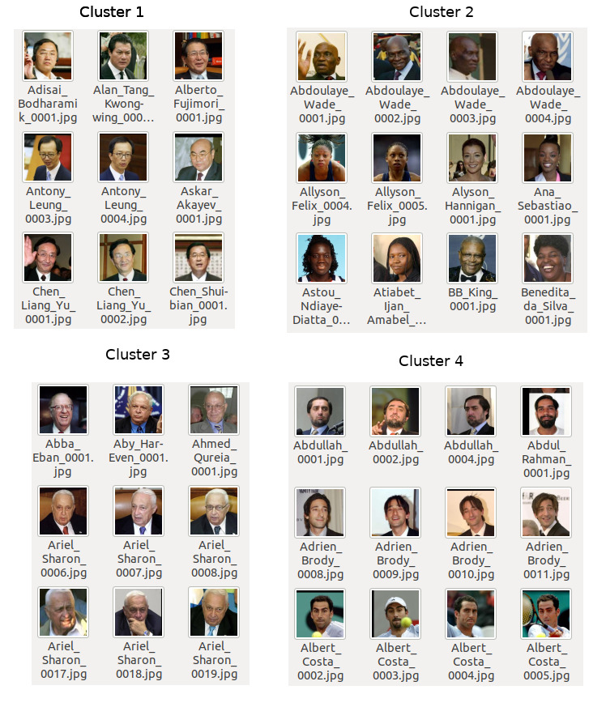

# Face Clustering with FaceNet and KMeans

Sort a large folder of portrait photos into clusters of the same person,
using a pretrained [FaceNet](https://github.com/davidsandberg/facenet)
model and KMeans clustering.

The pipeline is three small scripts, run in order:

| Step | Script | What it does |
|------|--------|--------------|
| 1 | `export_embeddings.py` | Detects and aligns each face, then extracts a 128-dim FaceNet embedding for it |
| 2 | `distance_matrix.py` | Computes the full N×N matrix of Euclidean distances between all embeddings |
| 3 | `cluster_faces.py` | Sorts the images into a nearest-neighbor chain, then splits them into KMeans clusters |



**How it works.** FaceNet maps every face to a 128-dimensional vector
(an *embedding*). Photos of the same person land close together in that
space, different people land far apart. Step 2 turns the embeddings into
pairwise distances; step 3 uses those distances to (a) order the images
from most-similar to next-most-similar and (b) group them into KMeans
clusters.

---

## Project layout

```
face_clustering/
├── export_embeddings.py      # step 1
├── distance_matrix.py        # step 2
├── cluster_faces.py          # step 3
├── download_dataset.py       # LFW dataset helper (setup step 4)
├── requirements.txt
├── src/
│   ├── facenet.py            # FaceNet model loader
│   └── align/detect_face.py  # MTCNN face detector
├── models/                   # (you add) pretrained FaceNet
├── data/
│   ├── lfw/                  # (you add) image dataset
│   ├── sorted/               # ← output: images in similarity-chain order
│   └── clustered/            # ← output: KMeans clusters
└── np_embeddings/            # ← output: numpy arrays
```

Everything under `models/`, `data/` and `np_embeddings/` is data, not
code — it is git-ignored and (re)created during setup and the run.

## Requirements

- **Python 3.9 – 3.13** (tested with 3.12). No legacy TensorFlow 1.x is
  needed — the 2017 code runs on modern **TensorFlow 2.x** via the
  `tf.compat.v1` graph API.
- About **3 GB of free disk** for the full LFW example (dataset ≈ 200 MB,
  model ≈ 250 MB, distance matrix ≈ 1.4 GB, output copies ≈ 400 MB).

---

## Setup

### 1. Clone the repo and install dependencies

```bash
git clone https://github.com/pavelkrolevets/face_clustering.git
cd face_clustering
python3 -m venv .venv
source .venv/bin/activate          # Windows: .venv\Scripts\activate
pip install -r requirements.txt
```

### 2. Download the pretrained FaceNet model (≈ 183 MB)

The official 128-dim LFW model
([`20170512-110547`](https://drive.google.com/file/d/0B5MzpY9kBtDVZ2RpVDYwWmxoSUk/view)):

```bash
curl -L -o /tmp/20170512-110547.zip \
  "https://drive.google.com/uc?export=download&id=0B5MzpY9kBtDVZ2RpVDYwWmxoSUk"
unzip /tmp/20170512-110547.zip -d models/
```

This produces `models/20170512-110547/` with the `.meta` and `.ckpt`
files. The script looks there by default.

### 3. Download the MTCNN face-detector weights (≈ 2 MB total)

`src/align/detect_face.py` needs three small weight files. They are the
official MTCNN weights from the
[facenet repo](https://github.com/davidsandberg/facenet):

```bash
base=https://raw.githubusercontent.com/davidsandberg/facenet/master/src/align
curl -L -o src/align/det1.npy $base/det1.npy
curl -L -o src/align/det2.npy $base/det2.npy
curl -L -o src/align/det3.npy $base/det3.npy
```

### 4. Download the dataset

```bash
python download_dataset.py
```

This fetches the [LFW dataset](https://huggingface.co/datasets/DerrickUnleashed/LFW)
(13,233 images of 5,749 people) into `data/lfw/`. The original UMass host
is decommissioned, so the script automatically falls back to the Hugging
Face mirror.

Or use **your own photos** — the only requirement is the directory
layout: one subfolder per person, photos inside:

```
data/lfw/
├── person_a/
│   ├── 001.jpg
│   └── 002.jpg
└── person_b/
    └── 001.jpg
```

The folder names are used as the person labels. Adjust
`--data_dir` in step 1 if you put the dataset elsewhere.

---

## Running the pipeline

Run all three commands **from the repository root**. The scripts import
the `src/` package, so put it on the path once:

```bash
export PYTHONPATH="$PWD/src"       # Windows: set PYTHONPATH=%cd%\src
```

### Step 1 — Extract the face embeddings (~5 min for LFW)

```bash
python export_embeddings.py
```

For every image the script detects the face with the built-in MTCNN
network, crops and resizes it to 160×160, and runs FaceNet to produce
one L2-normalized 128-dim embedding. It writes:

- `np_embeddings/embeddings.npy` — the N×128 embedding matrix
- `np_embeddings/image_list.npy` — the source path of each row
- `np_embeddings/label_list.npy` / `label_strings.npy` — the person
  (folder) label of each row

Useful options (defaults in parentheses; run `--help` for all):

| Flag | Meaning | Default |
|------|---------|---------|
| `--data_dir` | directory with the images | `./data/lfw` |
| `--model_dir` | directory with the FaceNet model | `./models/20170512-110547` |
| `--image_batch` | images processed per batch (controls memory) | `500` |
| `--image_size` | square crop size in pixels | `160` |
| `--margin` | extra crop around the detected face, in pixels | `44` |
| `--embeddings_name` | output path for the embedding array | `./np_embeddings/embeddings.npy` |

### Step 2 — Compute the distance matrix (~15 s for LFW)

```bash
python distance_matrix.py
```

Reads `np_embeddings/embeddings.npy` and saves the N×N matrix of
Euclidean distances (zeros on the diagonal) to
`np_embeddings/matrix.npy`. For 13,233 images this is a **1.4 GB** file
— keep the ~3 GB free disk in mind for other dataset sizes.

### Step 3 — Sort and cluster (~1 min for LFW)

```bash
python cluster_faces.py
```

1. Walks the distance matrix as a nearest-neighbor chain and copies the
   images, in that order, to `data/sorted/0`, `data/sorted/1`, …
2. Runs KMeans (30 clusters by default) and copies each image to
   `data/clustered/<cluster_id>/`, keeping its original filename.

> **Tuning:** 30 clusters over thousands of different people will mix
> several people in most clusters — that is expected. Raise
> `n_clusters` in `cluster_faces.py` to get tighter, person-level
> folders; the more clusters, the more similar the faces inside each.

---

## Output

| Path | Contents |
|------|----------|
| `np_embeddings/embeddings.npy` | one 128-dim L2-normalized embedding per image |
| `np_embeddings/image_list.npy` | source path of each embedding (same row order) |
| `np_embeddings/label_list.npy` / `label_strings.npy` | integer / string person label per row |
| `np_embeddings/matrix.npy` | N×N Euclidean distance matrix |
| `data/sorted/0 … N-1` | images in similarity-chain order |
| `data/clustered/0 … 29/` | KMeans clusters, original filenames kept |

For a clean re-run, remove the previous outputs first:

```bash
rm -rf np_embeddings/*.npy data/sorted/* data/clustered/*
```

---

## Tips and troubleshooting

- **`ModuleNotFoundError: No module named 'facenet'`** — `PYTHONPATH`
  must point at `src/` (see the first command in *Running the pipeline*).
- **TensorFlow warnings** such as `The saved meta_graph is possibly from
  an older release…` are harmless — the 2017 model loads fine on TF 2.x.
- **An image with no detected face** does not abort the run; it is
  center-cropped and embedded anyway (the embedding is just less useful).
- **Row order is not alphabetical.** `image_list.npy` follows directory
  enumeration order; always index `embeddings` and `image_list`
  together, never assume order.
- **`data/sorted` files have no extension** and are byte-identical
  copies of the originals. The script prints each source path as it
  writes; to re-identify a sorted file later, match its file hash against
  the dataset.
- **macOS:** avoid browsing `data/lfw/` in Finder — every file inside a
  person folder (including a stray `.DS_Store`) is treated as an image.
- **The Google Drive model link stops working?** The model is the
  official one from the [facenet repo](https://github.com/davidsandberg/facenet);
  grab a copy from the pretrained-models section there.

## Disclaimer

This work is based on FaceNet — model, code and papers at
[davidsandberg/facenet](https://github.com/davidsandberg/facenet)
([paper](https://arxiv.org/abs/1503.06393)).
